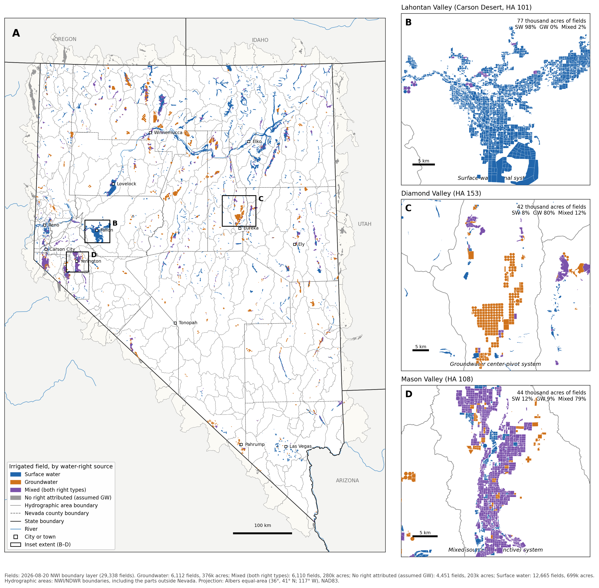
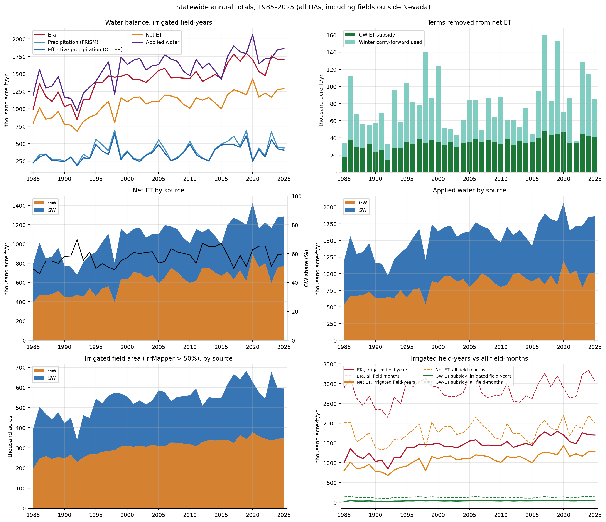
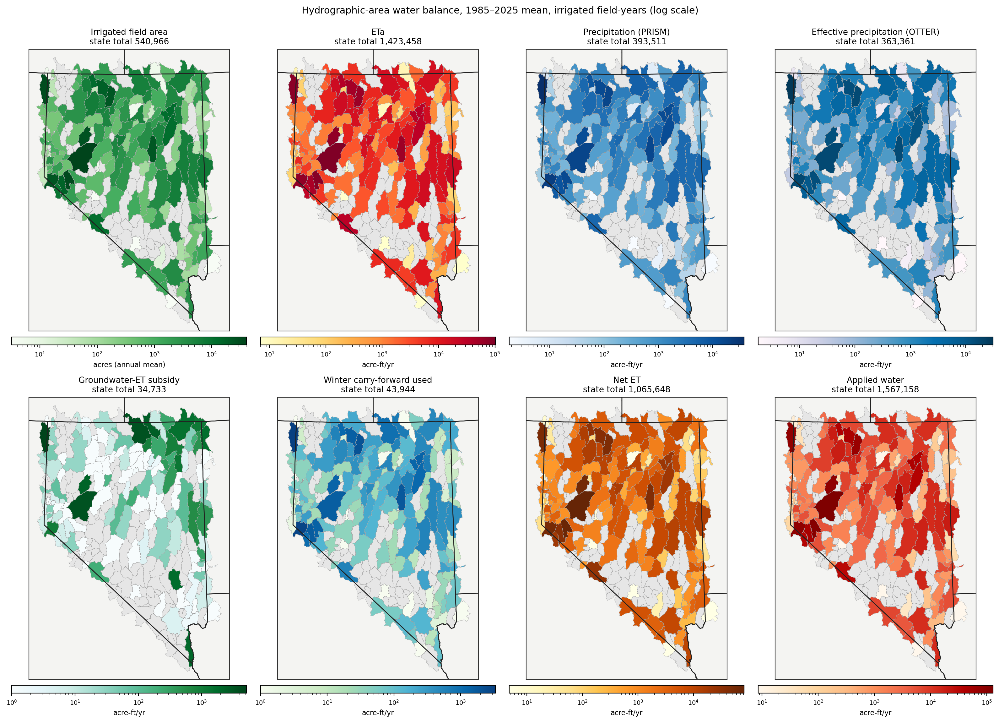
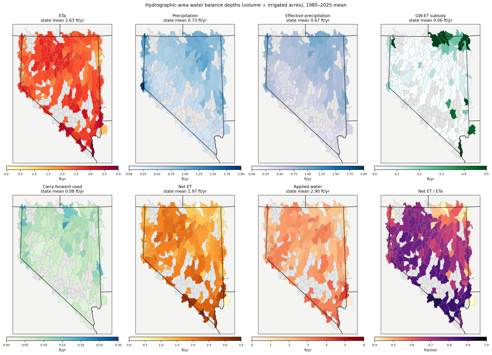
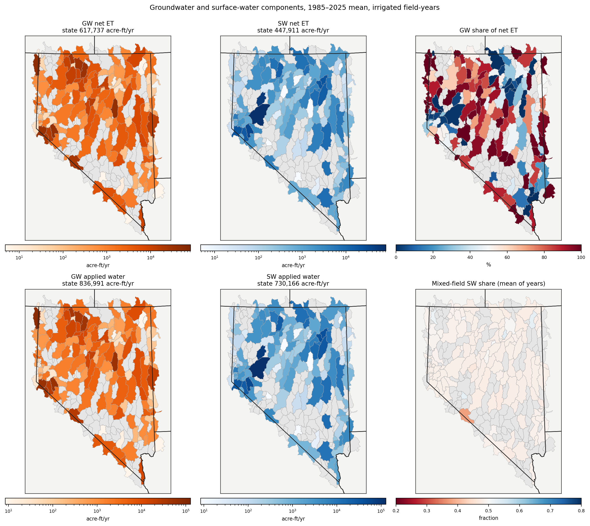
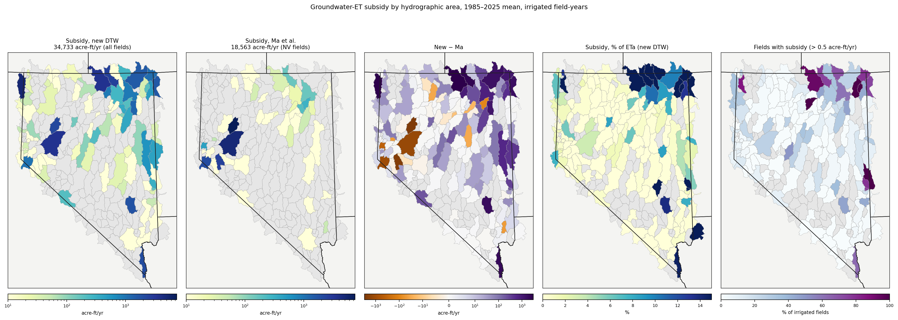

# nwi-t1-ag-water-use

Monthly agricultural water use for every irrigated field in the Nevada Water Initiative
(NWI T1) area, 1985–2025. For each field and month this repository computes:

- actual evapotranspiration (ETa), the water the field consumes, from OpenET;
- effective precipitation, the part of precipitation that stays in the root zone and is used
  by the crop;
- the groundwater-ET subsidy, the part of ETa supplied directly by shallow groundwater
  rather than by irrigation;
- winter soil-water carry-forward, precipitation stored in the soil over winter and used by
  the crop in spring;
- net ET (the irrigation requirement) and applied water (net ET divided by irrigation
  efficiency);
- the split of net ET and applied water between groundwater (GW) and surface water (SW).

Results are summed to hydrographic areas (HAs, the basins the Nevada Division of Water
Resources uses to manage water rights) and to Nevada counties.



## What was run

Run `nwi_t1_final_20261018`, configured by [`config/nwi_t1_final.yaml`](config/nwi_t1_final.yaml).

| Component | Setting |
|---|---|
| Fields | 29,338 fields of the 2026-08-20 NWI boundary layer, `nevada_agricultural_field_boundaries_20260820.gpkg` (24,882 in Nevada; the rest are out-of-state fields in HAs that cross the state line) |
| Water rights | Each field's water-right source from the Nevada Division of Water Resources (NDWR) place-of-use records: GW, SW, or mixed (both). Fields outside Nevada have no NDWR record and are treated as GW. In Diamond Valley (HA 153), mixed fields are treated as GW |
| ET | OpenET ensemble monthly ETa. A missing month is filled from the field's ratio of ETa to reference ET (EToF): a single missing month by straight-line interpolation between the months either side; a longer gap by the field's average EToF for that calendar month over the surrounding multi-year period (seven periods spanning 1985–2025) |
| Precipitation | PRISM 800 m daily precipitation at each field, summed by month |
| Effective precipitation | The OTTER model: a daily soil-water balance for each field's root zone, driven by the same PRISM precipitation and ET (settings in [docs/METHODS.md](docs/METHODS.md)) |
| GW-ET subsidy | f × ETa, where f is the fraction of ETa that groundwater can supply (Tan et al. 2025). f depends on the depth to groundwater (new statewide 100 m map `nv_dtw_parity_statewide_100m`, 2026-10-08 build of the handily NV parity model), soil texture (POLARIS), crop rooting depth and reference ET. Subtracted from net ET every month, but never more than that month's net ET |
| Winter carry-forward | In months when effective precipitation exceeds ETa, the surplus is stored in the soil (up to AWC × 1.5 m × field acres, where AWC is the soil's available water capacity). Stored water reduces net ET in later months. Storage is emptied every January and after any month with no ETa |
| Applied water | Net ET divided by the field's irrigation efficiency |
| GW/SW split | Mixed fields: the SW share in a year = 0.5 + 0.15 × the September 12-month Standardized Precipitation Index (SPI), limited to 0.2–0.8; the GW share is the rest. Fish Lake Valley (HA 117) uses the same rule centered on 0.36 and limited to 0.2–0.7 |
| SPI | Computed with the `climate_indices` package (gamma distribution), fitted to 1981–2024 and applied to every year. Precipitation is PRISM averaged over the area that drains surface water to the HA, or over the HA where no such area is defined |
| Summaries | HA and county totals include a field in a year only if IrrMapper marks more than half of it as irrigated that year (`%_IRRIGATED` > 0.5) |

The full method is in [docs/METHODS.md](docs/METHODS.md).

## Results (irrigated fields only, 1985–2025 annual mean, acre-ft/yr)

| | All | GW | SW |
|---|---:|---:|---:|
| ETa | 1,423,458 | 814,165 | 609,293 |
| Effective precipitation | 363,361 | 207,226 | 156,135 |
| GW-ET subsidy | 34,733 | 13,342 | 21,391 |
| Winter carry-forward used | 43,944 | 24,616 | 19,327 |
| **Net ET** | **1,065,648** | **617,737** | **447,911** |
| **Applied water** | **1,567,158** | **836,991** | **730,166** |
| Irrigated area (acres) | 540,966 | 304,192 | 236,773 |

These totals include the out-of-state fields of HAs that cross the state line. Nevada
fields alone have net ET 936,122 and applied water 1,366,930 acre-ft/yr. Each HA summary is
written twice: once for all fields and once for Nevada fields only (`_NV_fields_only`).

### Summary figures



**Statewide, by year.** ETa, precipitation, effective precipitation, net ET and applied
water; the GW-ET subsidy and carry-forward removed from net ET; net ET, applied water and
irrigated area split GW and SW.



**By hydrographic area.** Each water-balance term in acre-ft/yr (log scale); grey HAs have no
irrigated fields.



**By hydrographic area, as depths.** The same terms in ft (volume ÷ irrigated acres).



**Groundwater and surface water.** Net ET and applied water by source, the GW share of net
ET, and the average SW share of mixed fields.



**GW-ET subsidy by HA.** With the new depth-to-groundwater map and with the Ma et al. (2026)
map, their difference, the subsidy as a share of ETa, and the share of irrigated fields that
receive a subsidy.

Maps, time series and checks for every variable are on these pages:
- [docs/RESULTS.md](docs/RESULTS.md): the water balance, the GW/SW split of mixed fields, the input data, and irrigated area (IrrMapper compared with the XGBRF irrigation classifier).
- [docs/GW_SUBSIDY.md](docs/GW_SUBSIDY.md): the groundwater-ET subsidy and the comparison of the two depth-to-groundwater maps.

## Outputs

Outputs are written to `<output_root>/<run_id>/` (set in the config), outside the repository.
Every column is defined in [docs/DATA_DICTIONARY.md](docs/DATA_DICTIONARY.md). Changes from the
files delivered on 2026-08-23 (field and HA) and 2026-09-02 (county), column by column, are in
[docs/legacy/COLUMN_CROSSWALK.md](docs/legacy/COLUMN_CROSSWALK.md).

| Path | Content |
|---|---|
| `05_field_summaries/field_summaries_EToF_final{,_GW,_SW}.{csv,parquet}` | One row per field and month, for every field and month. No suffix = whole field; `_GW` and `_SW` split each mixed field by its share for that year (GW + SW = whole field) |
| `06_summaries/ha_summaries_EToF_final{,_GW,_SW}.csv` | One row per HA, year and month, irrigated fields only, every field in the HA (including out-of-state fields) |
| `06_summaries/ha_summaries_EToF_final{,_GW,_SW}_NV_fields_only.csv` | The same, Nevada fields only |
| `06_summaries/county_wide_summaries_EToF_final{,_GW,_SW}.csv` | One row per Nevada county, year and month, irrigated fields only |
| `06_summaries/dynamic_allocation_stats.csv` | SW share of mixed fields and the SPI used, per HA and year |
| `06_summaries/statewide_annual_totals.csv` | Statewide annual volumes, for irrigated fields only and for all fields and months |

## Running

```bash
conda env create -f environment.yml
cd scripts && PY=python PY_EXACT=python ./run_all.sh
cd ../figures && ./run_figures.sh
```

`PY` is the Python used for all steps. `PY_EXACT` is the Python used for step 3; it must have
the `exactextract` package, which computes how much of each 100 m pixel lies inside each field.

The scripts are copies of the original agricultural-water-forecasting, OTTER and
nwi-gw-subsidy scripts, edited for this workflow. Each edit is marked `# NWI T1`; sources and
versions are in [scripts/ORIGINAL_SOURCES.md](scripts/ORIGINAL_SOURCES.md).

| Step | Script | Writes |
|---|---|---|
| 1 | `phase1_data_preparation/aggregate_field_prism_monthly.py` | Monthly PRISM precipitation and reference ET per field |
| 1 | `phase1_data_preparation/calculate_field_climatologies.py` | Each field's average EToF per calendar month, for each of the seven periods (used to fill gaps) |
| 1 | `phase1_data_preparation/calculate_basin_spi.py` | Monthly PRISM SPI per HA (or per area draining to it) |
| 2 | `otter/run_nv_otter_prism_monthly.py` | Monthly OTTER effective precipitation per field |
| 3 | `gw_subsidy/main.py all` | Depth to groundwater per field, POLARIS soil texture, groundwater fraction f |
| 4 | `phase1_data_preparation/process_field_summaries.py` | Field water balance, carry-forward, GW/SW split, field files, HA and county summaries |
| 5 | `qa/bridge_qa.py`, `qa/compare_runs.py` | Checks: rerun of the 2026-08-23 settings against the delivered files, totals as each new setting is added, and comparison of two runs |

Step 3 reads POLARIS soil texture from Google Earth Engine (project `nasa-water`) for any
field not already in the run's saved texture file. `tests/test_fast_equivalence.py`
checks that three steps rewritten to run faster (carry-forward, gap filling from the
calendar-month averages, GW/SW split) give the same results as the original code.


---

How this workflow relates to earlier NWI processing (code sources, the rerun of the
2026-08-23 settings, and the totals as each setting changes) is in
[docs/legacy/](docs/legacy/LINEAGE.md).
