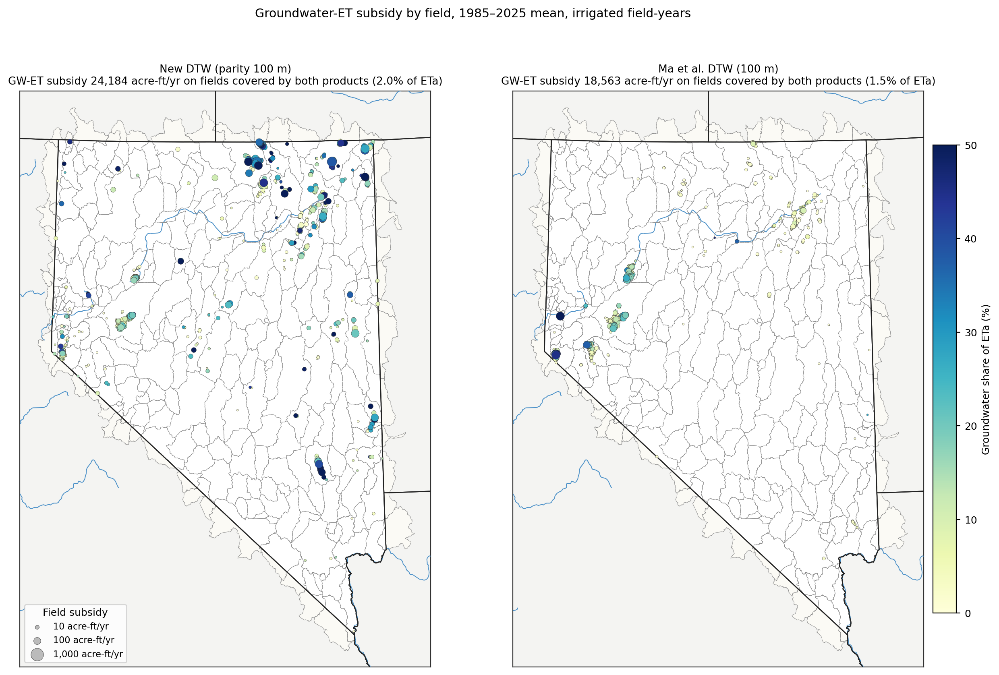
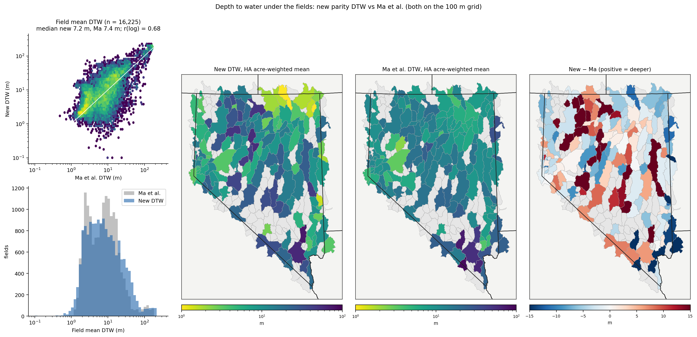
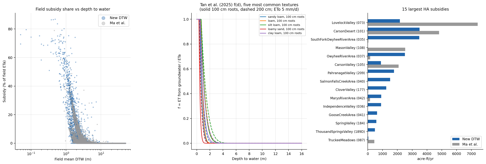
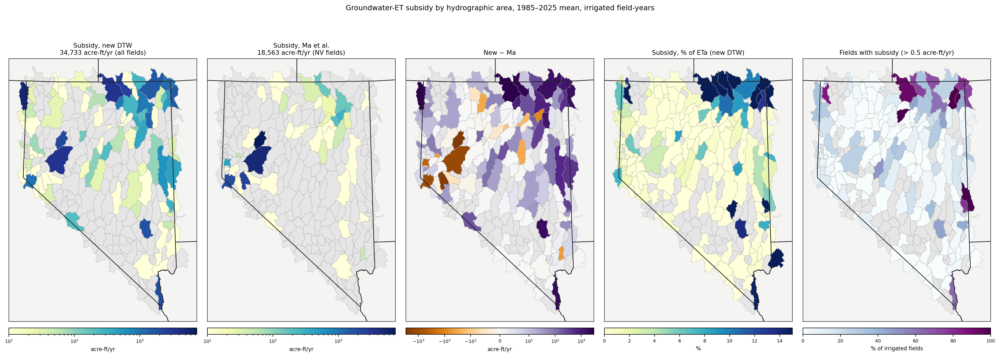
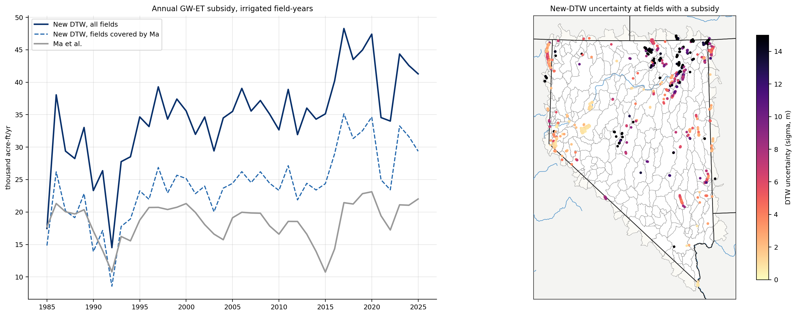

# Groundwater-ET subsidy and depth to groundwater

The groundwater-ET (GW-ET) subsidy is the part of a field's ETa supplied directly by
shallow groundwater: f × ETa. Here f is the fraction of ETa that groundwater can supply,
from Tan et al. (2025), given the field's depth to groundwater, soil texture, rooting depth
and reference ET (ETo) (see [METHODS.md](METHODS.md)). The subsidy is subtracted from net ET
in every field-month, but never more than that month's net ET.

The run uses the new statewide 100 m depth-to-groundwater map, `nv_dtw_parity_statewide_100m`
(handily NV parity model, build of 2026-10-08; projection EPSG:5070). The figures compare it with
the Ma et al. (2026) map, which the earlier subsidy work used. Both maps are put on the same 100 m
grid and go through the same steps: depth averaged over each field's pixels, the same Tan et al.
parameters, and the same water balance. The comparison depends on that grid (see Map build and
grid below). Volumes are 1985–2025 annual averages, for fields in years when IrrMapper marks more
than half of the field as irrigated.

| | Value |
|---|---|
| GW-ET subsidy, all fields | 34,733 acre-ft/yr (2.4% of ETa) |
| Fields covered by both maps (16,225 irrigated fields) | new map 24,184 acre-ft/yr; Ma et al. 18,563 acre-ft/yr |
| Median of the field-average depth to groundwater (fields covered by both maps) | new 7.2 m; Ma 7.4 m |
| Correlation between the two maps' field-average depths (on a log scale) | 0.68 |
| Table by HA | `docs/tables/ha_gw_subsidy_new_vs_ma.csv` |

**Map build and grid.** The handily bucket (`gs://ucrc-wtd/handily/nv/`) now holds only a later
30 m build of the same model (`handily_dtw_nv_parity_30m.tif`, 2026-10-21), which this run did not
use. Computed with the run's code on that map, with Ma et al. averaged onto the same 30 m grid
(`gee/README.md`), the subsidy is 31,746 acre-ft/yr for all fields, 8.6% less than above; on the
fields both maps cover it is 24,210 acre-ft/yr, close to the 24,184 above. On that common 30 m grid
Ma et al. gives 28,630 acre-ft/yr, more than the new map: averaging Ma et al. onto 100 m hides narrow
shallow areas that the steep Tan et al. curve credits most. The "more subsidy with the new map" result
below therefore holds for the 100 m grid only.

**Fig. 10.** Subsidy by field with each map: circle size = acre-ft/yr, color = share of the
field's ETa. Compared with Ma et al. on the 100 m grid, the new map gives:
- **More subsidy** in the northern meadow basins (South Fork Owyhee 3,479 vs 35 acre-ft/yr;
  Owyhee River, Salmon Falls Creek, Goose Creek) and Pahranagat Valley (1,776 vs 1).
- **Less subsidy** in Lovelock Valley (2,175 vs 7,425), Mason Valley (5 vs 2,532), Carson Desert
  (3,503 vs 4,820) and Carson Valley (1,007 vs 2,084).
- **Coverage outside Nevada.** The Ma et al. map covers Nevada only, so the out-of-state
  fields of Surprise Valley (5,123 acre-ft/yr, the largest HA subsidy), Colorado Valley (2,016
  of its 2,019 acre-ft/yr, on California fields), Grouse Creek Valley, and part of Goose Creek
  (494 of its 1,125 acre-ft/yr, in Idaho and Utah) have a subsidy only with the new map.

**Fig. 11.**
- **Field-average depth to groundwater.** The two maps have similar medians (new 7.2 m, Ma 7.4 m;
  the figure title gives Ma first).
  The new map is shallower in the northern meadows (South Fork Owyhee 2 vs 7 m, Salmon
  Falls 2 vs 8 m), deeper in Lovelock (6 vs 2 m), and deeper in many central basins.
- **HA averages.** Depth to groundwater averaged over each HA's fields, weighted by field
  acres, for each map, and their difference.

**Fig. 12.**
- **Subsidy share against depth.** f falls steeply as the field-average depth to
  groundwater increases:

  | Field-average depth to groundwater | Average f |
  |---|---:|
  | < 1 m | 0.77 |
  | 1–2 m | 0.22 |
  | 2–3 m | 0.05 |
  | 3–4 m | 0.015 |
  | > 4 m | < 0.005 |

  Fields whose average depth is more than 4 m get a subsidy only from shallower 100 m
  pixels inside the field.
- **Tan et al. curves of f against depth.** Shown for the five most common soil textures.
- **Basin ranking.** The 15 largest HA subsidies with each map.

**Fig. 13.** HA subsidy with each map (log scale), the difference between them, the
subsidy as a share of ETa, and the share of irrigated fields that receive a subsidy.

**Fig. 14.**
- **Annual subsidy.** It follows ETa from year to year.
- **Uncertainty of the new map.** The new map's uncertainty layer (standard deviation of
  depth) at fields with a subsidy is largest in the northern meadows, where the subsidy is
  also largest.
