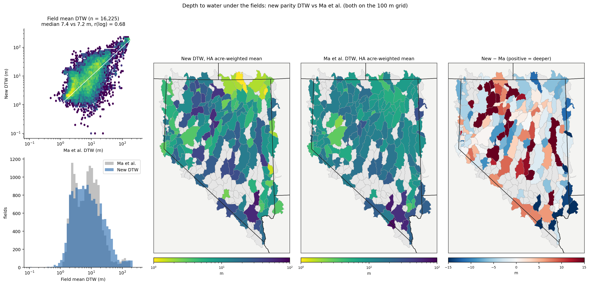
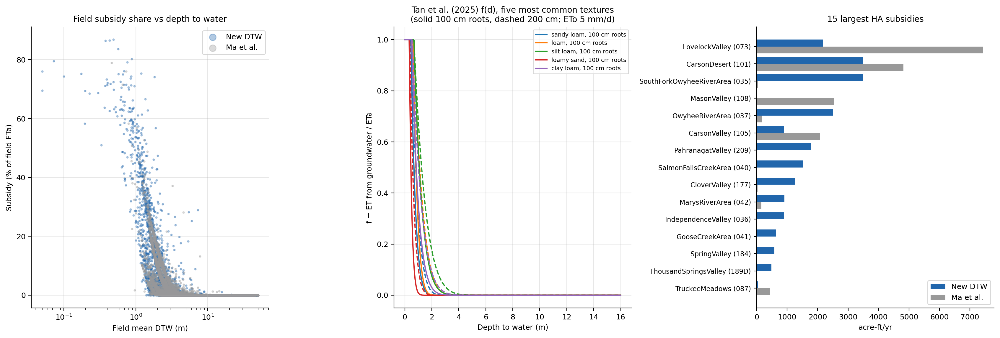
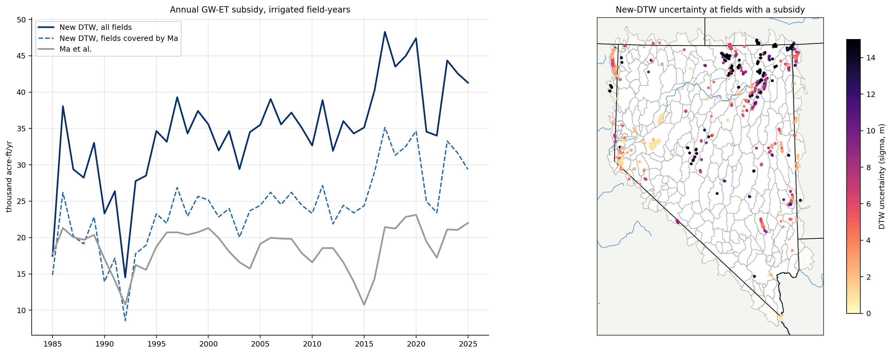

# Groundwater-ET subsidy and depth to water

The GW-ET subsidy is the part of a field's ETa met by shallow groundwater, f × ETa. Here f is
the Tan et al. (2025) groundwater fraction for the field's depth to water, texture, rooting
depth and ETo (see [METHODS.md](METHODS.md)). The subsidy is subtracted from net ET in every
field-month, up to that month's positive requirement.

The depth-to-water (DTW) product is `nv_dtw_parity_statewide_100m` (100 m, EPSG:5070).
The figures compare it with Ma et al. (2026). Both products are on the same 100 m grid and
go through the same zonal statistics, Tan parameters and water balance. Volumes are
1985–2025 means over irrigated field-years.

| | Value |
|---|---|
| GW-ET subsidy, all fields | 34,733 acre-ft/yr (2.4% of ETa) |
| Fields covered by both DTW products (16,225 irrigated fields) | new DTW 24,184 acre-ft/yr; Ma et al. 18,563 acre-ft/yr |
| Field mean DTW, median (common fields) | new 7.4 m; Ma 7.2 m |
| Field mean DTW, log correlation | 0.68 |
| HA table | `docs/tables/ha_gw_subsidy_new_vs_ma.csv` |

**Fig. 10.** Subsidy by field with each DTW product: bubble size = acre-ft/yr, color = share
of the field's ETa. Compared with Ma et al., the new DTW gives:
- **More subsidy** in the northern meadow basins (South Fork Owyhee 3,479 vs 35 acre-ft/yr;
  Owyhee River, Salmon Falls Creek, Goose Creek) and Pahranagat Valley (1,776 vs 1).
- **Less subsidy** in Lovelock Valley (2,175 vs 7,425), Carson Desert (3,503 vs 4,820) and
  Carson Valley (1,007 vs 2,084).
- **Coverage outside Nevada.** Ma et al. covers Nevada only, so the out-of-state fields of
  Surprise Valley (5,123 acre-ft/yr, the largest HA subsidy) and Grouse Creek Valley have a
  subsidy only under the new DTW.

**Fig. 11.**
- **Field mean DTW.** The two products have similar medians (7.4 vs 7.2 m). The new product
  is shallower in the northern meadows (South Fork Owyhee 2 vs 7 m, Salmon Falls 2 vs 8 m),
  deeper in Lovelock (6 vs 2 m), and deeper in many central basins.
- **HA means.** Acre-weighted mean DTW per HA for each product, and their difference.

**Fig. 12.**
- **Field subsidy share vs DTW.** The subsidy falls steeply with field mean DTW:

  | Field mean DTW | Mean f |
  |---|---:|
  | < 1 m | 0.77 |
  | 1–2 m | 0.22 |
  | 2–3 m | 0.05 |
  | 3–4 m | 0.015 |
  | > 4 m | < 0.005 |

  Fields deeper than 4 m get a subsidy only from shallow pixels inside the field.
- **Tan f(d) curves.** Shown for the five most common textures.
- **Basin ranking.** The 15 largest HA subsidies under each product.

**Fig. 13.** HA subsidy under each product (log scale), the difference between them, the
subsidy as a share of ETa, and the share of irrigated fields with a subsidy.

**Fig. 14.**
- **Annual subsidy.** It follows ETa from year to year.
- **DTW uncertainty.** The new DTW's sigma at fields with a subsidy is largest in the
  northern meadows, where the subsidy is also largest.
