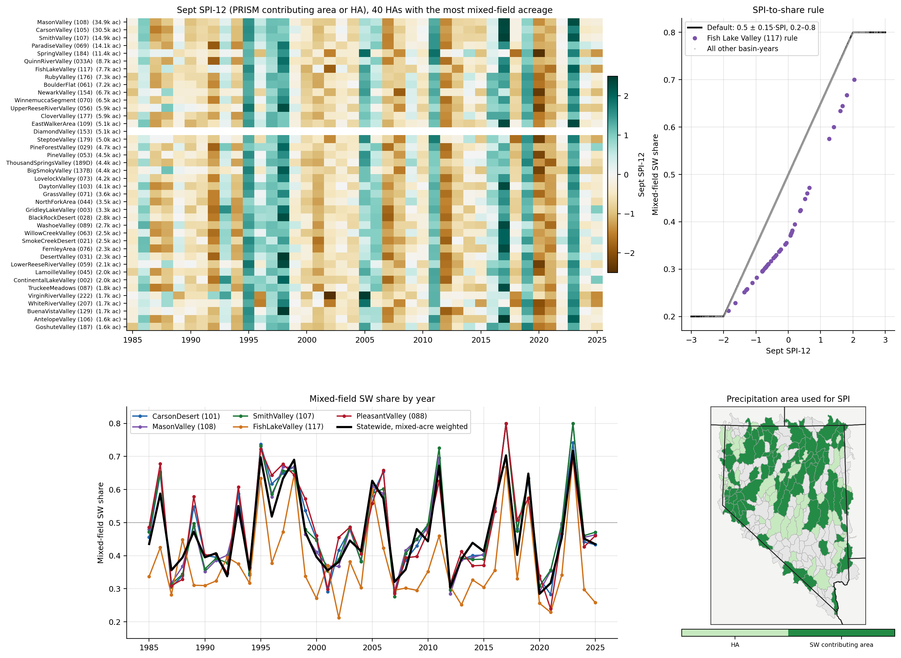

# Methods

All settings are in `config/nwi_t1_final.yaml`. The scripts in `scripts/` run in order
(`run_all.sh`) and write into one output folder per run, `<output_root>/<run_id>/`.

Terms used on this page:

| Term | Meaning |
|---|---|
| ETa | Actual evapotranspiration: the water the field consumes |
| ETo | Reference evapotranspiration (OpenET gridMET): the demand of a standard grass surface |
| EToF | ETa ÷ ETo |
| Effective precipitation (Peff) | Precipitation minus runoff and minus water that drains below the root zone |
| Net ET | ETa minus effective precipitation, minus the groundwater-ET subsidy and stored soil water used: the irrigation requirement |
| Applied water | Net ET ÷ irrigation efficiency |
| HA | Hydrographic area: the basins the Nevada Division of Water Resources uses to manage water rights |
| GW, SW, mixed | Water-right source: groundwater, surface water, or both |
| Field-month, field-year | One field in one month, or in one year |

## Fields

- **Fields.** 29,338 fields of the 2026-08-20 NWI boundary layer,
  `nevada_agricultural_field_boundaries_20260820.gpkg` (24,882 NV; 2,361 CA;
  1,509 UT; 275 ID; 274 OR; 37 AZ), monthly, 1985–2025.
- **Hydrographic area.** Each field belongs to the HA named in its `Basin` attribute in the
  boundary layer. HAs that cross the state line include their out-of-state fields.
- **Water-right source** (`IRR_SRC`): GW, SW or mixed, from the Nevada Division of Water
  Resources place-of-use records attached to each field in the boundary layer. The 4,451
  fields outside Nevada have no Nevada record and are treated as GW (`IRR_SRC_ASSUMED`).
- **Irrigation efficiency and type** (`irr_eff`, `ITYPE`): from the OpenET field export.
- **Basin rules.**
  - Diamond Valley (HA 153): mixed fields are treated as GW.
  - Fish Lake Valley (HA 117): the SW share of mixed fields is centered on 0.36 and limited
    to 0.2–0.7 (Rush & Katzer).

## 01 ET and precipitation

**ETa** comes from the monthly OpenET ensemble export for the 2026-08-20 fields:

- A value of −999 or an ETa of exactly 0 is treated as missing.
- EToF = ETa ÷ ETo.
- A single missing month is filled by straight-line interpolation of EToF between the
  months before and after it.
- A longer gap is filled with the field's average EToF for that calendar month, taken from
  the multi-year period that contains the gap. There are seven periods covering 1985–2025:
  1985–91, 1992–97, 1998–2003, 2004–09, 2010–15, 2016–21 and 2022–25. Each average uses only
  observed EToF, limited to 0–1.5
  (`scripts/phase1_data_preparation/calculate_field_climatologies.py`).
- 1,194 field-months have no observed EToF for that calendar month in their period and stay
  missing.
- ETa volume = EToF × ETo × acres.

**Precipitation** is PRISM 800 m daily precipitation at each field's center point, summed by
month. It was extracted with Google Earth Engine (project `nasa-water`). The same extraction
holds the daily OpenET gridMET ETo used by OTTER.

## 02 Effective precipitation (OTTER)

OTTER runs a daily soil-water balance for each field's root zone, continuously from
1985-01-01.

- **Soil and runoff inputs, per field and year.** `aws_u`: plant-available water the upper
  root zone can hold. `aws_max`: plant-available water the whole root zone can hold. `cn`:
  runoff curve number (SCS curve-number method).
- **Settings.** Both the upper and lower root zones start half depleted
  (`init_dru_frac = init_drl_frac = 0.5`). Irrigation is assumed to keep the upper root zone
  from drying past half of what it can hold (`mad_frac = 0.5`).
- **Daily inputs.** PRISM precipitation and ETo; daily ET = ETo × the field's gap-filled
  EToF for that month (the same EToF as ETa).
- **Output.** Effective precipitation on a day = precipitation − runoff − water that drains
  below the lower root zone, summed by month.
- **Fields without soil data.** 242 fields have no usable soil inputs. They use 0.85 × PRISM
  precipitation (`peff_method = ppt_085_fallback`).

## 03 Standardized Precipitation Index (SPI)

- **Index.** SPI from the `climate_indices` package, gamma distribution, monthly. The
  distribution is fitted once, to 1981–2024, and that fit is used for every year.
- **Precipitation.** PRISM monthly precipitation averaged over the area that drains surface
  water to the HA, where such an area is defined; otherwise averaged over the HA.
- **Use.** The 12-month SPI ending in September of year Y sets the SW share of mixed fields
  for calendar year Y.

## 04 Groundwater-ET fraction

f is the fraction of ETa that shallow groundwater can supply (Tan et al. 2025):

```
f(d) = 1                                   d ≤ d_dec
     = ((d_ext − d) / (d_ext − d_dec))^p   d_dec < d < d_ext
     = 0                                   d ≥ d_ext
```

- **d** is the depth to groundwater, from the new statewide 100 m depth-to-groundwater map
  `nv_dtw_parity_statewide_100m` (projection EPSG:5070), which covers every field, including
  those outside Nevada.
- **d_dec** is the depth above which groundwater supplies all of ETa; **d_ext** is the depth
  below which it supplies none; **p** sets how fast f falls between them. Tan et al. give
  these for each combination of:
  - POLARIS soil texture class, averaged over 0–100 cm;
  - rooting depth: 200 cm where the field's dominant crop (`CROP_major`, USDA Cropland Data
    Layer) is alfalfa, an orchard or vineyard crop, forest, shrubland or wetland; otherwise
    100 cm;
  - the field's April–October average ETo.
- **Field value.** f is computed for every 100 m pixel that touches the field and averaged,
  each pixel weighted by the share of it that lies inside the field.
- **Which fields.** Every field can receive the subsidy; there is no basin-level filter.

## 05 Field water balance

For each field-month:

```
NetET_pre_subsidy      = ETa − effective precipitation
GW_subsidy             = min(f × ETa, max(NetET_pre_subsidy, 0))
NetET_vol_intermediate = NetET_pre_subsidy − GW_subsidy
```

The GW subsidy is subtracted in every field-month, like effective precipitation. It can only
reduce a positive net ET to zero; it never makes net ET negative, so groundwater is never
added to soil storage.

**Winter carry-forward.**

- When `NetET_vol_intermediate` is negative (effective precipitation exceeds ETa), the
  surplus is stored in the soil, up to AWC × 1.5 m × acres. Anything above that limit is
  recorded as overflow and lost.
- In later months with a positive net ET, the stored water is used first.
- Storage is emptied every January and after any month with no ETa.

```
NetET_final = max(NetET_vol_intermediate − stored water used, 0)
AR_final    = NetET_final / irr_eff
```

**GW/SW split.**

- Mixed fields: the SW share in year Y = 0.5 + 0.15 × the September 12-month SPI of year Y,
  limited to 0.2–0.8. The GW share is 1 minus that.
- GW fields are 100% GW, and SW fields are 100% SW.
- The GW and SW files multiply every volume and the acreage of a mixed field by its share.
  Every run checks that GW + SW equals the whole-field total.



**Fig. 7.**
- **SPI by HA and year.** The 12-month SPI ending in September, for the 40 HAs with the most
  mixed-field acreage.
- **The share rule.** SW share = 0.5 + 0.15 × SPI, limited to 0.2–0.8. The Fish Lake Valley
  rule (centered on 0.36, limited to 0.2–0.7) is shown separately.
- **Shares by year.** The resulting SW share of mixed fields for selected basins and
  statewide.
- **Area used for the SPI precipitation.** Which HAs use the area that drains surface water
  to them, and which use the HA itself.

## 06 HA and county summaries

The summaries include a field in a year only if IrrMapper marks more than half of it as
irrigated that year (`%_IRRIGATED` > 0.5). All volumes of an included field-year count,
including its GW subsidy and carry-forward.

- **HA summaries, two files each.** One with every field in the HA, including the
  out-of-state fields of HAs that cross the state line. One with Nevada fields only
  (`_NV_fields_only`).
- **County summaries.** Nevada fields only.

How each summary column is calculated is in [DATA_DICTIONARY.md](DATA_DICTIONARY.md).
