# Results

Run `nwi_t1_final_20261016`, 1985–2025. Unless a figure says otherwise, values cover
irrigated field-years (IrrMapper `%_IRRIGATED` > 0.5), the population of the HA and county
summaries, across all HAs including their fields outside Nevada. Means are 1985–2025
annual means.

## Statewide water balance

| Term (acre-ft/yr) | All | GW | SW |
|---|---:|---:|---:|
| ETa | 1,423,458 | 814,165 | 609,293 |
| Precipitation (PRISM) | 393,511 | 224,047 | 169,464 |
| Effective precipitation (OTTER) | 363,361 | 207,226 | 156,135 |
| GW-ET subsidy | 34,733 | 13,342 | 21,391 |
| Winter carry-forward used | 43,944 | 24,616 | 19,327 |
| Net ET | 1,065,648 | 617,737 | 447,911 |
| Applied water | 1,567,158 | 836,991 | 730,166 |
| Irrigated field area (acres) | 540,966 | 304,192 | 236,773 |

Nevada fields and out-of-state fields (acre-ft/yr; out-of-state fields are treated as GW):

| Term | Nevada fields | Out-of-state fields |
|---|---:|---:|
| ETa | 1,235,255 | 188,203 |
| GW-ET subsidy | 24,043 | 10,691 |
| Net ET | 936,122 | 129,526 |
| Applied water | 1,366,930 | 200,228 |

The largest out-of-state net ET is in Surprise Valley (014, California side; 48,895
acre-ft/yr), Antelope Valley (106; 17,188), Snake Valley (195; 9,444), Colorado Valley
(213; 9,212) and Fish Lake Valley (117; 7,665).

Depths over the irrigated area: ETa 2.63 ft, net ET 1.97 ft, applied water 2.90 ft.
Irrigated area ranges from 338,920 acres (1992) to 682,724 acres (2019).

## 1. Fields, water rights and hydrographic areas

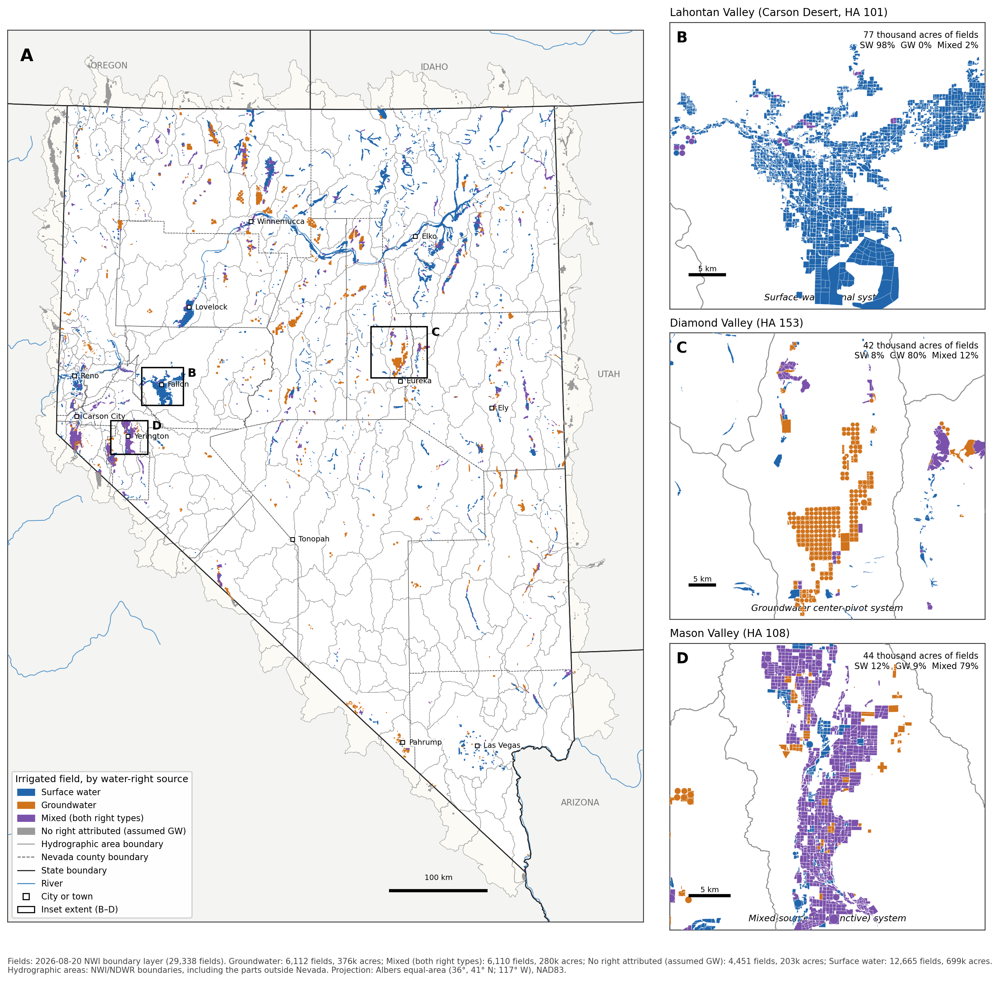

**Fig. 1.** The 29,338 fields, colored by water-right source. Hydrographic-area outlines
include the parts of HAs outside Nevada, which hold the 4,451 out-of-state fields (grey;
no Nevada right attributed, treated as GW). The insets show the three main systems:

| Inset | Area | System |
|---|---|---|
| B | Lahontan Valley | Surface-water canals |
| C | Diamond Valley | Groundwater pivots |
| D | Mason Valley | Mixed (conjunctive) use |

## 2. Hydrographic-area water balance

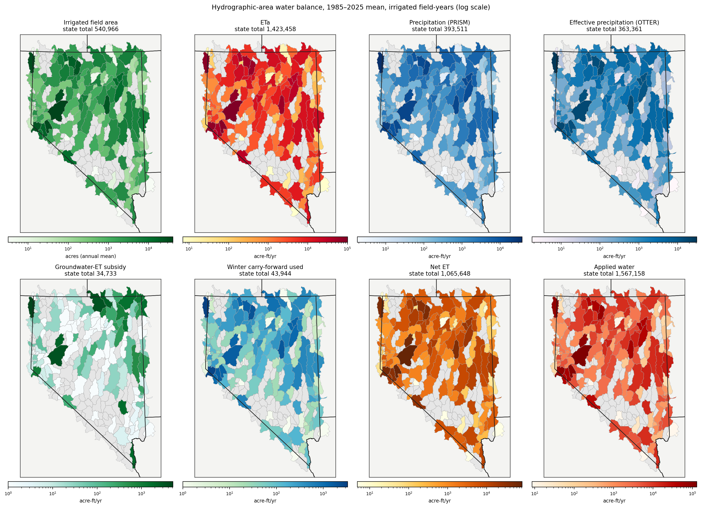

**Fig. 2.** Each water-balance term by HA, as acre-ft/yr on a log scale; grey HAs have no
irrigated fields. The largest net-ET basins are:

| Basin | Net ET (acre-ft/yr) |
|---|---:|
| Carson Desert (101) | 82,136 |
| Mason Valley (108) | 72,855 |
| Lovelock Valley (073) | 56,912 |
| Carson Valley (105) | 54,923 |
| Surprise Valley (014) | 48,980 |
| Paradise Valley (069) | 45,662 |

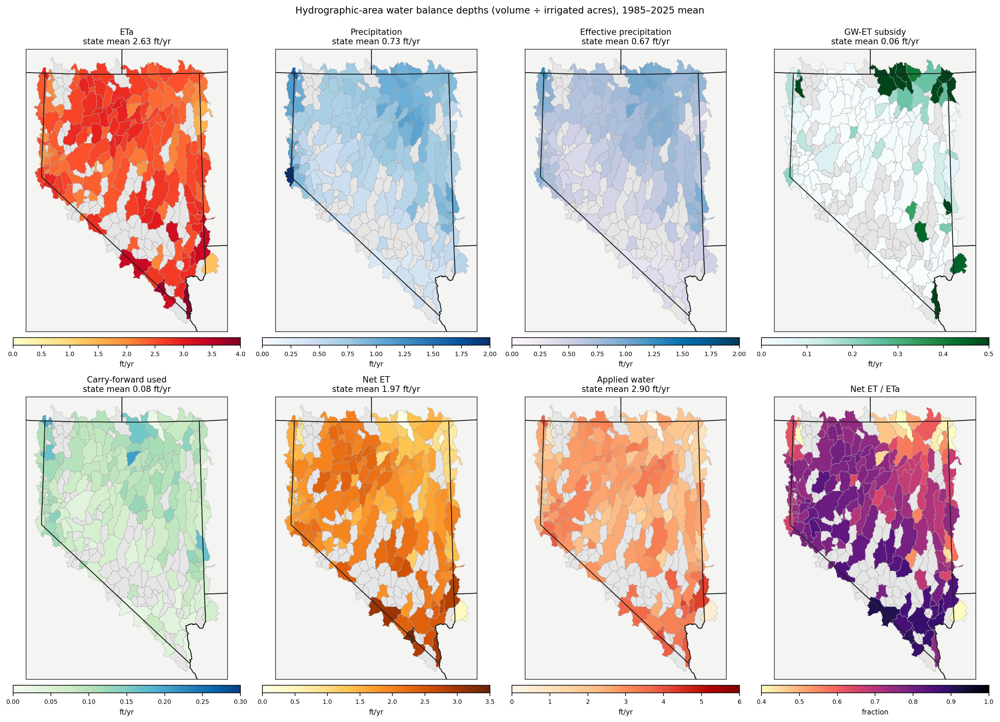

**Fig. 3.** The same terms as depths (volume ÷ irrigated acres), plus net ET / ETa. ETa
depth is highest in the southern basins. Subsidy depth is highest in the northern
meadow basins (Bruneau River, Thousand Springs, Goose Creek, South Fork Owyhee), along the
Colorado River (213) and in Pahranagat Valley.

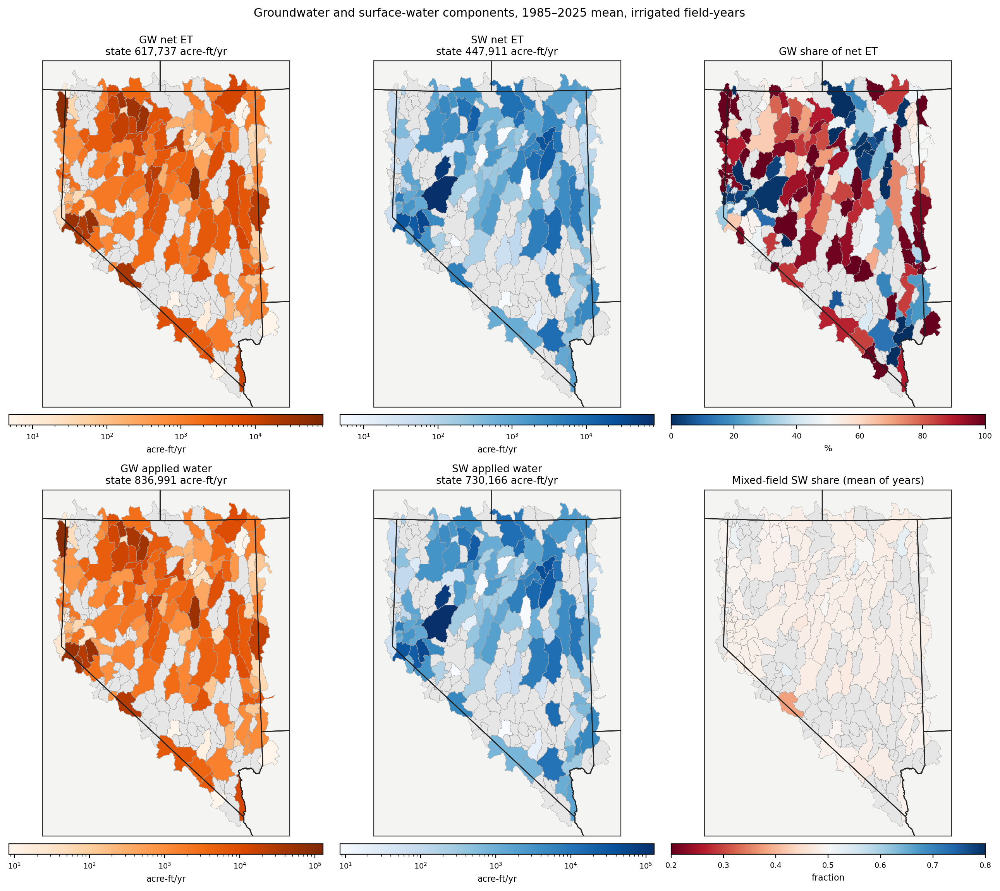

**Fig. 4.**
- **Net ET and applied water by source.** Panels show GW and SW volumes on a shared color
  scale.
- **GW share of net ET.** The percentage of each HA's net ET supplied by groundwater.
- **Mixed-field SW share.** The mean over years of the share allocated to surface water.

## 3. Statewide time series

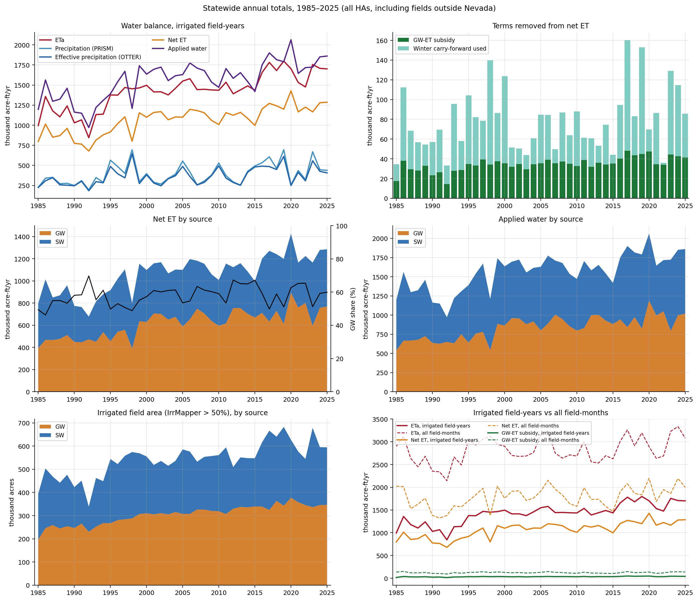

**Fig. 5.**
- **Water balance.** Annual ETa, precipitation, Peff, net ET and applied water.
- **Removed from net ET.** The GW-ET subsidy and the winter carry-forward used.
- **By source.** Net ET, applied water and irrigated area, split GW and SW.
- **Population check.** Irrigated field-years (solid) against all field-months (dashed).

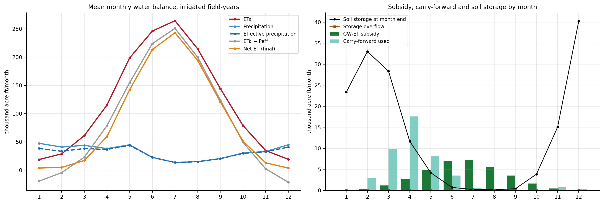

**Fig. 6.**
- **Mean monthly water balance.** From October, precipitation exceeds ETa and the surplus is
  stored. Storage resets each January and refills to about 33,000 acre-ft by February.
  Carry-forward then returns that water to net ET from March to June, peaking in April
  (about 17,600 acre-ft). Storage is near zero from July to September.
- **Subsidy timing.** The GW-ET subsidy peaks in June and July (about 7,000 acre-ft/month).

## 4. SW/GW allocation

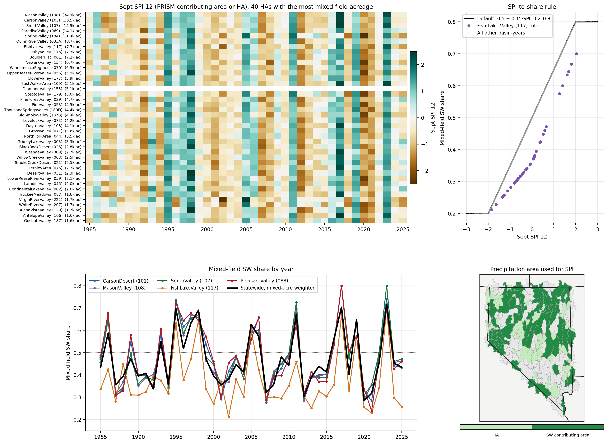

**Fig. 7.**
- **SPI by HA and year.** Sept SPI-12 for the 40 HAs with the most mixed-field acreage.
- **The share rule.** SW share = clip(0.5 + 0.15 × SPI, 0.2, 0.8). The Fish Lake Valley rule
  is shown separately.
- **Shares by year.** The resulting mixed-field SW share for selected basins and statewide.
- **SPI precipitation source.** Which HAs use their surface-water contributing area and
  which use the HA itself.

## 5. Inputs and gap filling

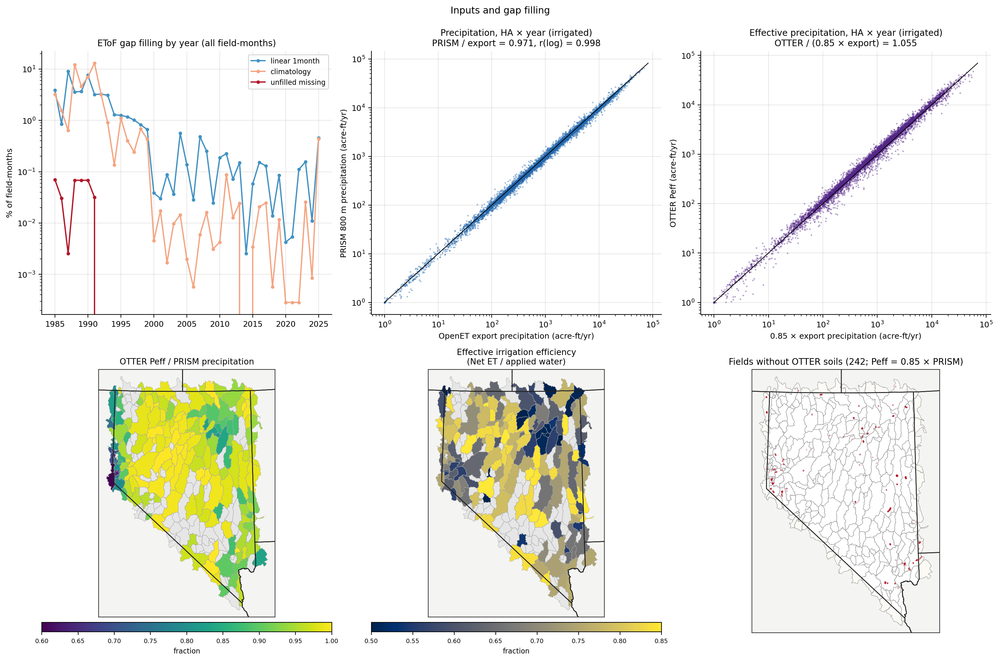

**Fig. 8.**
- **EToF gap filling.** The share of field-months filled linearly or from climatology, or
  left missing, by year. Gaps are mostly before 2000; 1,194 field-months stay missing.
- **Precipitation.** PRISM precipitation against the OpenET export precipitation, by HA and
  year.
- **Effective precipitation.** OTTER Peff against 0.85 × export precipitation.
- **OTTER Peff / precipitation by HA.** Lowest in the Sierra-front basins, where winter
  precipitation runs off or percolates below the root zone.
- **Effective irrigation efficiency.** Net ET / applied water, by HA.
- **Fallback fields.** The 242 fields whose Peff is 0.85 × PRISM.

## 6. Irrigated area: IrrMapper and XGBRF

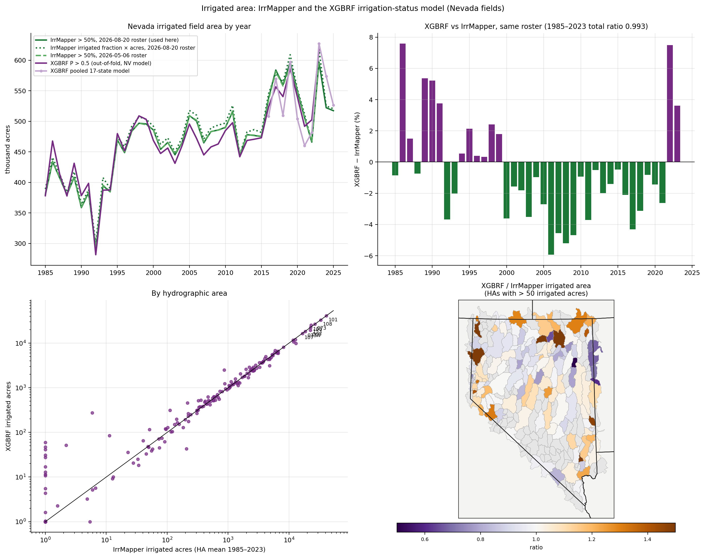

**Fig. 9.** Nevada irrigated area from three sources:
- IrrMapper on the 2026-08-20 fields, which is the status used in the summaries;
- IrrMapper on the 2026-05-06 fields;
- the XGBRF irrigation-status model (`field-irrigation-classification`): out-of-fold Nevada
  model 1985–2023, and the pooled 17-state model 2016–2025.

XGBRF predictions are keyed to the 2026-05-06 fields, so the two products are compared on
that roster, by year and by HA. Annual totals are in `docs/tables/irrigated_area_by_year.csv`.

## 7. Groundwater-ET subsidy and depth to water

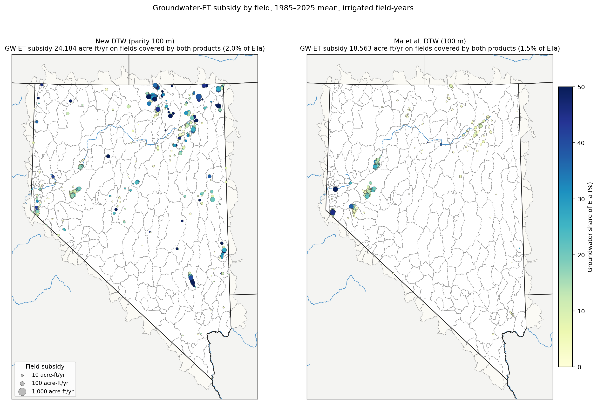

**Fig. 10.** Subsidy by field with each depth-to-water product: bubble size = acre-ft/yr,
color = share of the field's ETa.

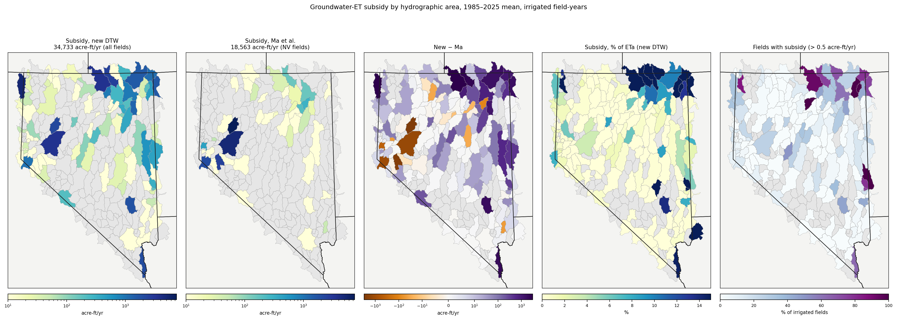

**Fig. 13.** HA subsidy under each product (log scale), the difference between them, the
subsidy as a share of ETa, and the share of irrigated fields with a subsidy.

[GW_SUBSIDY.md](GW_SUBSIDY.md) has the full subsidy method and the depth-to-water comparison
with Ma et al. (Figs. 10–14).
