# Results

Run `nwi_t1_final_20261018`, 1985–2025. Unless a figure says otherwise, values include a
field in a year only if IrrMapper marks more than half of it as irrigated that year
(`%_IRRIGATED` > 0.5), the same rule as the HA and county summaries, and cover all HAs
including their fields outside Nevada. Values are annual averages over 1985–2025. Terms are
defined at the top of [METHODS.md](METHODS.md).

## Statewide water balance

| Term (acre-ft/yr) | All | GW | SW |
|---|---:|---:|---:|
| ETa | 1,423,458 | 814,165 | 609,293 |
| Precipitation (PRISM) | 393,511 | 224,047 | 169,464 |
| Effective precipitation (OTTER) | 363,361 | 207,226 | 156,135 |
| GW-ET subsidy | 34,733 | 13,342 | 21,391 |
| Winter carry-forward used | 43,944 | 24,616 | 19,327 |
| Net ET | 1,065,648 | 617,737 | 447,911 |
| Applied water | 1,567,158 | 836,991 | 730,166 |
| Irrigated field area (acres) | 540,966 | 304,192 | 236,773 |

Nevada fields and out-of-state fields (acre-ft/yr; out-of-state fields are treated as GW):

| Term | Nevada fields | Out-of-state fields |
|---|---:|---:|
| ETa | 1,235,255 | 188,203 |
| GW-ET subsidy | 24,043 | 10,691 |
| Net ET | 936,122 | 129,526 |
| Applied water | 1,366,930 | 200,228 |

The largest out-of-state net ET is in Surprise Valley (014, California side; 48,895
acre-ft/yr), Antelope Valley (106; 17,188), Snake Valley (195; 9,444), Colorado Valley
(213; 9,212) and Fish Lake Valley (117; 7,665).

Depths over the irrigated area: ETa 2.63 ft, net ET 1.97 ft, applied water 2.90 ft.
Irrigated area ranges from 338,920 acres (1992) to 682,724 acres (2019).

## 1. Fields, water rights and hydrographic areas

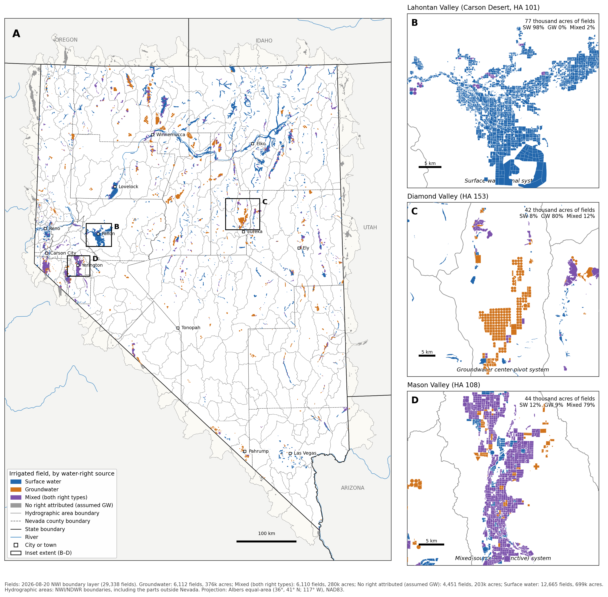

**Fig. 1.** The 29,338 fields, colored by water-right source. Hydrographic-area outlines
include the parts of HAs outside Nevada, which hold the 4,451 out-of-state fields (grey;
no Nevada water right on record, treated as GW). The insets show the three main kinds of
irrigation supply:

| Inset | Area | System |
|---|---|---|
| B | Lahontan Valley | Surface-water canals |
| C | Diamond Valley | Groundwater pivots |
| D | Mason Valley | Mixed: both surface water and groundwater |

## 2. Hydrographic-area water balance

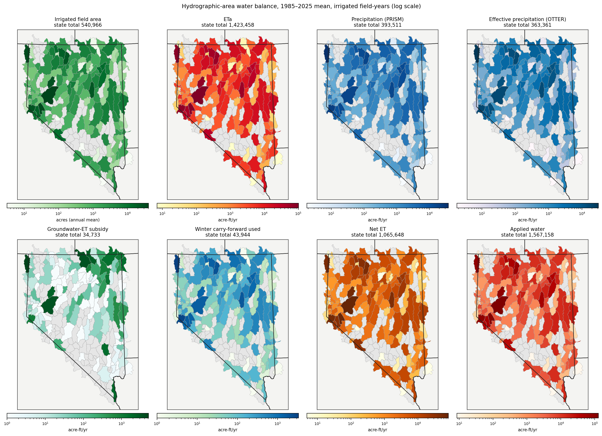

**Fig. 2.** Each water-balance term by HA, as acre-ft/yr on a log scale; grey HAs have no
irrigated fields. The largest net-ET basins are:

| Basin | Net ET (acre-ft/yr) |
|---|---:|
| Carson Desert (101) | 82,136 |
| Mason Valley (108) | 72,855 |
| Lovelock Valley (073) | 56,912 |
| Carson Valley (105) | 54,923 |
| Surprise Valley (014) | 48,980 |
| Paradise Valley (069) | 45,662 |

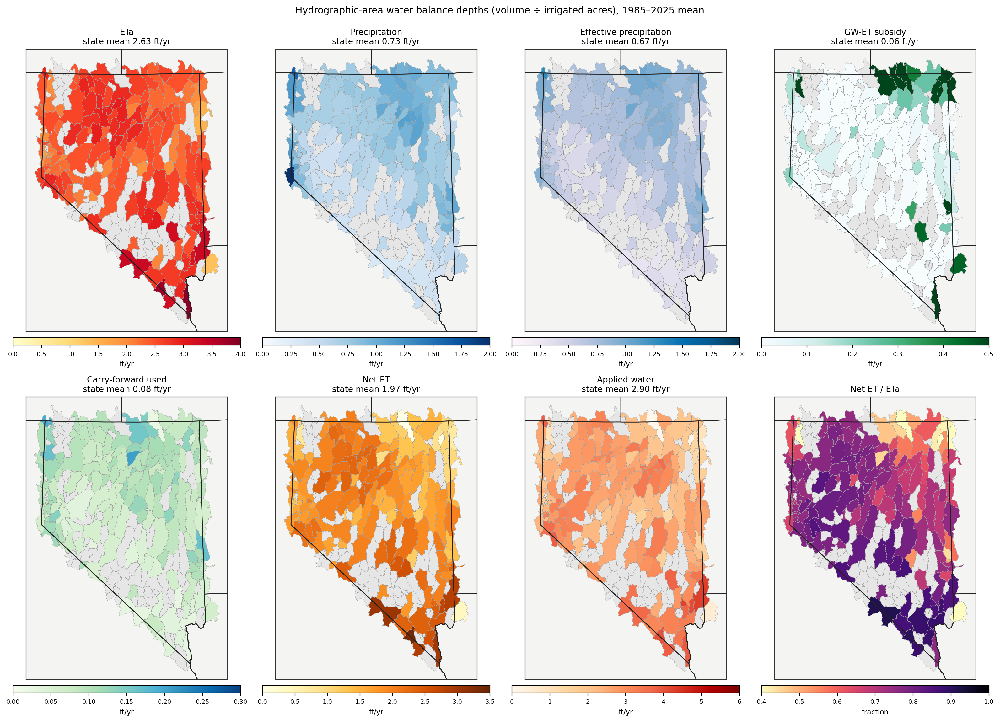

**Fig. 3.** The same terms as depths (volume ÷ irrigated acres), plus net ET as a share of
ETa. ETa
depth is highest in the southern basins. Subsidy depth is highest in the northern
meadow basins (Bruneau River, Thousand Springs, Goose Creek, South Fork Owyhee), along the
Colorado River (213) and in Pahranagat Valley.

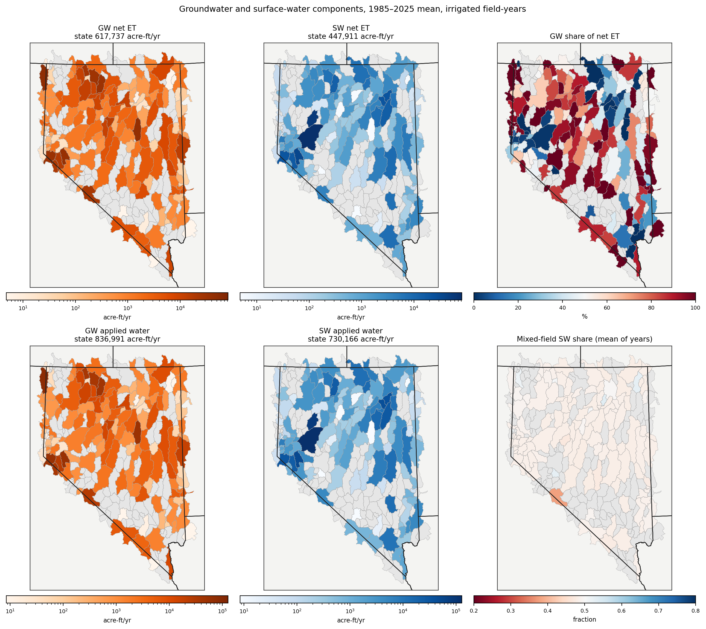

**Fig. 4.**
- **Net ET and applied water by source.** Panels show GW and SW volumes on a shared color
  scale.
- **GW share of net ET.** The percentage of each HA's net ET supplied by groundwater.
- **Mixed-field SW share.** The mean over years of the share allocated to surface water.

## 3. Statewide time series

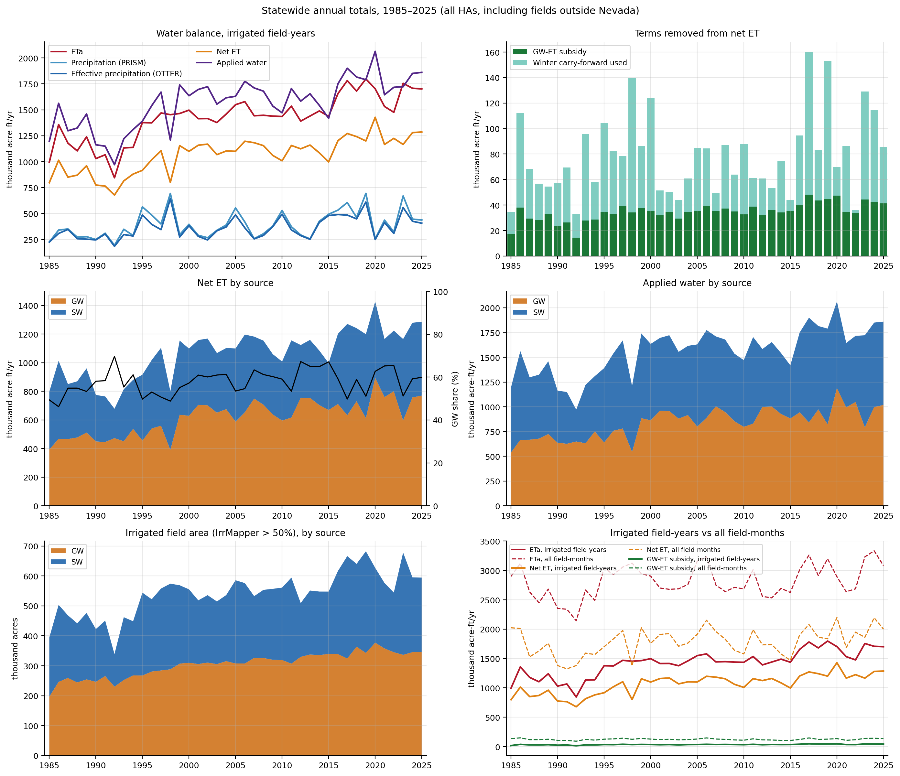

**Fig. 5.**
- **Water balance.** Annual ETa, precipitation, effective precipitation, net ET and applied
  water.
- **Removed from net ET.** The GW-ET subsidy and the winter carry-forward used.
- **By source.** Net ET, applied water and irrigated area, split GW and SW.
- **Irrigated fields only compared with all fields.** Totals for irrigated fields only
  (solid) and for every field and month (dashed).

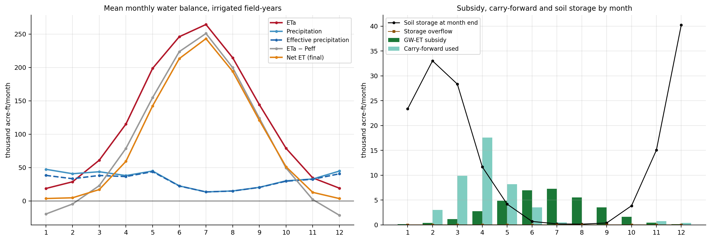

**Fig. 6.**
- **Average monthly water balance.** From October, precipitation exceeds ETa and the
  surplus is stored in the soil. Storage is emptied each January and refills to about
  33,000 acre-ft by February. The stored water then reduces net ET from March to June, most
  in April (about 17,600 acre-ft). Storage is near zero from July to September.
- **Subsidy timing.** The GW-ET subsidy peaks in June and July (about 7,000 acre-ft/month).

## 4. Input data and gap filling

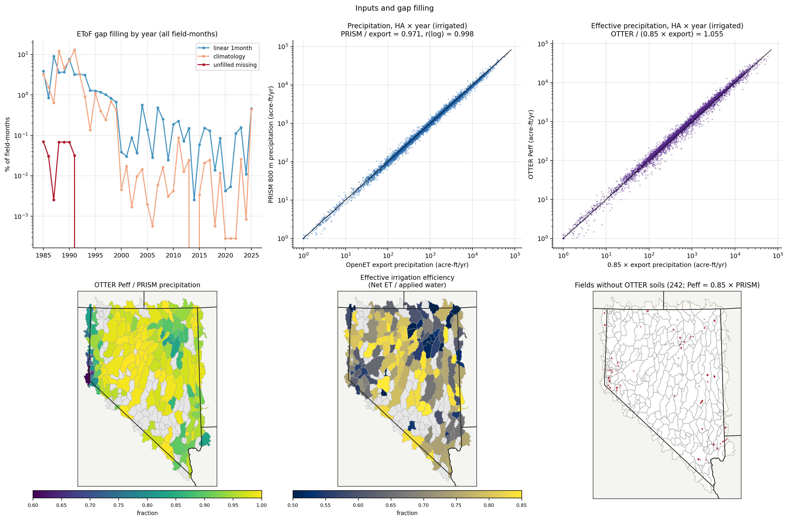

**Fig. 8.**
- **ETa gap filling.** By year, the share of field-months filled by interpolation, filled
  from the field's calendar-month average EToF, or left missing. Gaps are mostly before
  2000; 1,194 field-months stay missing.
- **Precipitation.** PRISM precipitation compared with the precipitation in the OpenET field
  export (which the earlier processing used), by HA and year.
- **Effective precipitation.** OTTER effective precipitation compared with 0.85 × the export
  precipitation (the earlier method).
- **OTTER effective precipitation as a share of precipitation, by HA.** Lowest in the basins
  along the Sierra Nevada, where winter precipitation runs off or drains below the root zone.
- **Effective irrigation efficiency.** Net ET ÷ applied water, by HA.
- **Fields without OTTER soil inputs.** The 242 fields whose effective precipitation is
  0.85 × PRISM precipitation.

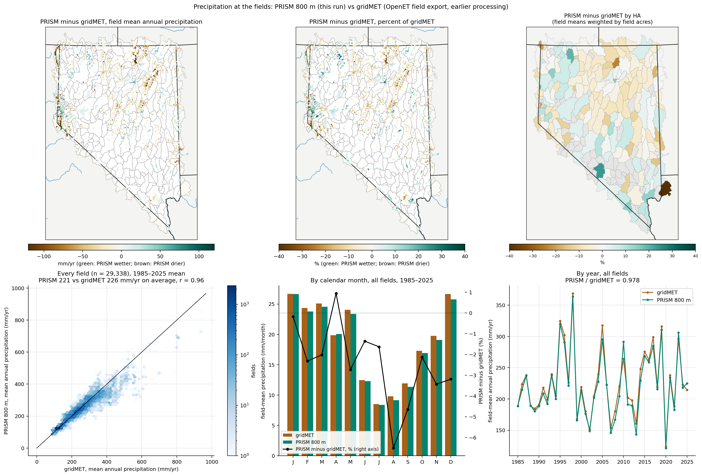

**Fig. 15. Precipitation at each field, PRISM 800 m against gridMET.** PRISM is the
precipitation this run uses. gridMET is the precipitation in the OpenET field export, which
the earlier processing used. The comparison covers all 29,338 fields and every month,
1985–2025. A field's value is the average of its annual totals.

- **Across Nevada the two agree.** The average field gets 221 mm/yr from PRISM and 226 mm/yr
  from gridMET (PRISM 2.2% lower). The median field difference is −0.4 mm/yr, and the
  correlation between the two field averages is 0.96.
- **Field by field they can differ a lot.** PRISM is more than 10% wetter at 9% of fields
  and more than 10% drier at 12% of fields.
- **Where PRISM is drier (basins with at least 20 fields):**
  - Independence Valley (036): −24%.
  - Lemmon Valley (092A), north of Reno: −20%.
  - Hamlin Valley (196): −15%.
  - Clover Valley (204): −15%.
  - Walker Lake Valley (110A): −12%.

  On the field maps the largest differences, in mm/yr, are on fields along the
  California line south of Reno and in the high valleys of northeastern Nevada.
- **Where PRISM is wetter:**
  - Pine Forest Valley (029): +20%.
  - Marys Creek Area (052): +16%.
  - Hualapai Flat (024): +15%.
  - Mesquite Valley (163): +14%.
  - Spanish Springs Valley (085): +11%.
  - Dayton Valley (103): +10%.
- **Small basins.** Basins with only a few fields can differ more, for example Greasewood
  Basin (224): −41%, 5 fields.
- **By month.** PRISM is lower than gridMET in every month except April. The gap is
  largest in August (−6.5%) and September (−4.6%), the months of summer thunderstorms.
- **By year.** The two move together from year to year.
- **Table by HA.** `docs/tables/precip_prism_vs_gridmet_by_ha.csv`.

### What moving OTTER from 4 km gridMET to 800 m PRISM changes

To isolate the effect of the precipitation source, the final run was repeated with gridMET
precipitation and nothing else changed (QA variant `v5_gridmet_otter_peff`):

- **gridMET inputs.** Monthly precipitation is the OpenET export's. OTTER is rerun with each
  field's daily gridMET cell precipitation, from the cell files ET-Demands reads.
- **Same as the final run:** ETo, EToF, soils and OTTER settings. ETa, acres and potential
  GW-ET subsidy are identical in the two runs.
- **Coverage.** The gridMET cell files cover the Nevada fields and end in April 2024, so the
  comparison is Nevada fields, 1985–2023.

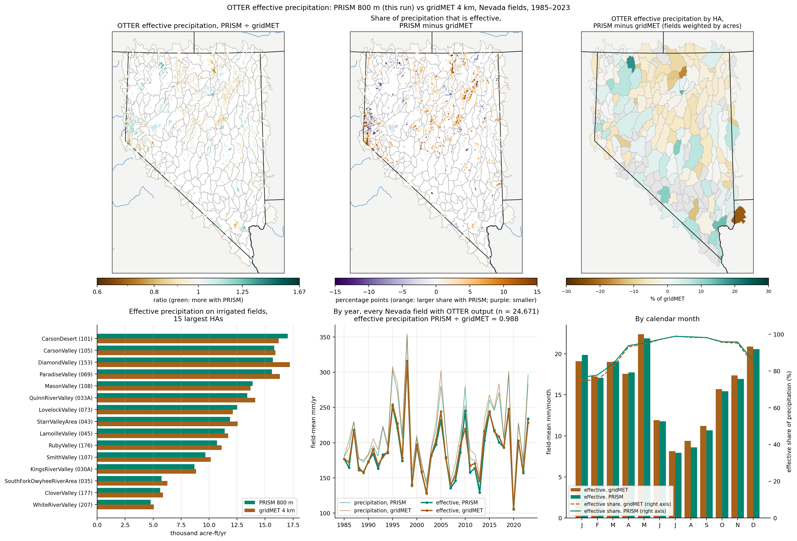

**Fig. 16. OTTER effective precipitation at the fields.** All 24,671 Nevada fields with OTTER
output, every month.

- **Statewide.** PRISM gives 2.3% less precipitation than gridMET (210 vs 215 mm/yr per
  field) but only 1.2% less effective precipitation (188 vs 190 mm/yr).
  - With less precipitation, less of it runs off or drains below the root zone, so the
    effective share is a little higher with PRISM: 89.2% against 88.2%.
  - The difference in effective share is in winter (December–February, about 2 percentage
    points). From May to October nearly all precipitation is effective with either source.
- **Field by field.**
  - Half of the fields are within 4% (ratio 0.96–1.04).
  - 90% are within about 10% (0.89–1.10).
  - Fewer than 1% differ by more than 20%.
- **By HA.** The pattern follows the precipitation difference of Fig. 15.
  - PRISM gives less effective precipitation in Independence Valley (036, −18%), Indian
    Springs Valley (161, −12%), Willow Creek Valley (063, −11%) and Walker Lake Valley
    (110A, −10%).
  - It gives more in Pine Forest Valley (029, +19%), Marys Creek Area (052, +15%) and Black
    Mountains Area (215, +14%).

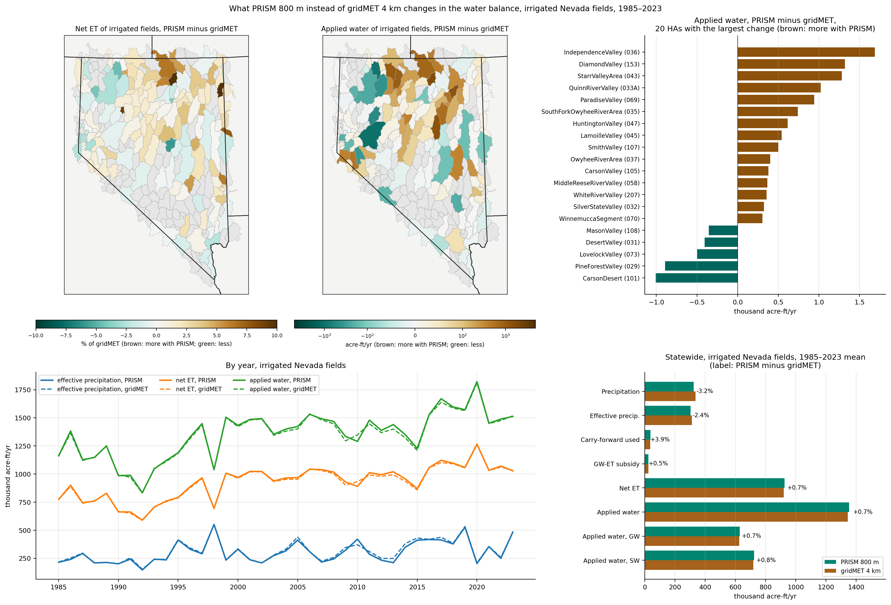

**Fig. 17. Water balance of irrigated fields.** HA summaries, Nevada fields only.

Statewide, 1985–2023 average, acre-ft/yr:

| | PRISM 800 m | gridMET 4 km | Difference |
|---|---:|---:|---:|
| Precipitation | 324,595 | 335,443 | −10,848 (−3.2%) |
| Effective precipitation | 303,851 | 311,336 | −7,485 (−2.4%) |
| Stored soil water used (carry-forward) | 36,966 | 35,578 | +1,388 (+3.9%) |
| GW-ET subsidy | 23,720 | 23,608 | +112 (+0.5%) |
| Net ET | 926,231 | 920,207 | +6,024 (+0.7%) |
| Applied water | 1,353,602 | 1,344,101 | +9,501 (+0.7%) |
| Applied water, GW | 629,458 | 625,355 | +4,103 (+0.7%) |
| Applied water, SW | 724,144 | 718,746 | +5,398 (+0.8%) |

- **Statewide the effect is small.** Moving to PRISM raises net ET and applied water by
  0.7%.
  - Part of the lost effective precipitation comes back as stored winter soil water used in
    spring.
  - The GW and SW split moves in proportion. The SPI that sets the split uses PRISM in both
    runs.
- **No trend over time.** From year to year the change in applied water ranges from −4.3%
  (2010) to +3.1% (2009) and changes sign.
- **Basins where PRISM raises applied water.**
  - Independence Valley (036): +1,688 acre-ft/yr (+13%).
  - Diamond Valley (153): +1,318 (+2.7%).
  - Starr Valley Area (043): +1,281 (+3.3%).
  - Quinn River Valley (033A): +1,023 (+2.3%).
  - Paradise Valley (069): +941 (+1.4%).
  - South Fork Owyhee River Area (035): +739 (+6.4%).
- **Basins where PRISM lowers applied water.**
  - Carson Desert (101): −1,006 acre-ft/yr (−0.8%).
  - Pine Forest Valley (029): −893 (−4.6%).
  - Lovelock Valley (073): −498 (−0.6%).
- **Points to check.**
  - Independence Valley is the one large outlier. There PRISM has 24% less precipitation
    than gridMET (Fig. 15), and applied water rises 13%. A comparison with nearby station
    precipitation would show which source is closer.
  - The northeastern basins (Independence, Starr, Huntington, Lamoille, South Fork Owyhee)
    all get more applied water with PRISM. This is the area where Fig. 15 shows PRISM
    drier on the high valley fields.
- **Table by HA.** Precipitation, effective precipitation, net ET and applied water with
  each source: `docs/tables/otter_prism_vs_gridmet_by_ha.csv`.

## 5. Irrigated area: IrrMapper and the XGBRF classifier

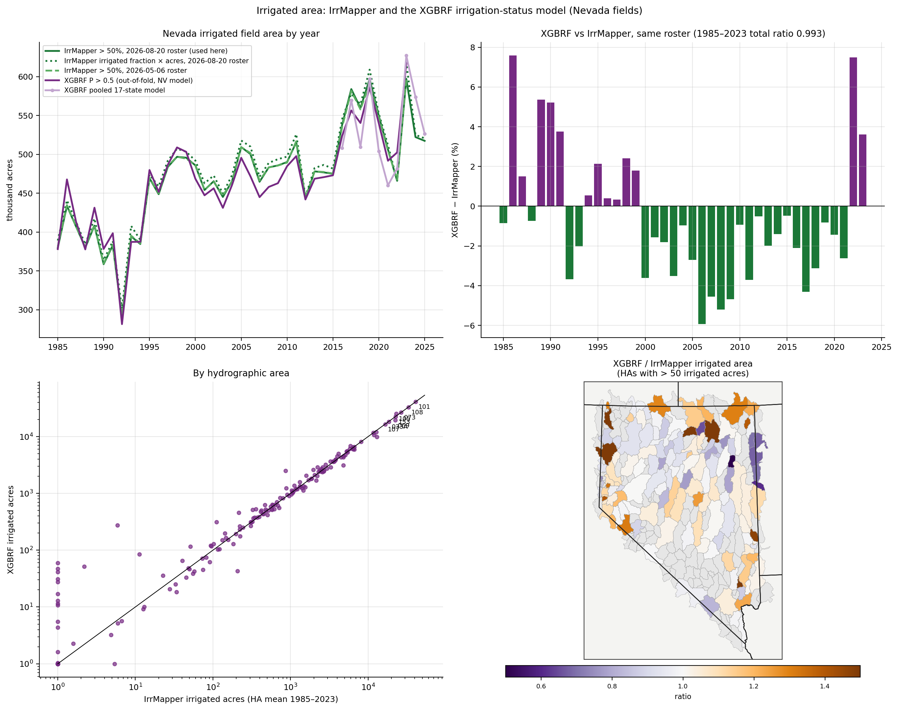

**Fig. 9.** Nevada irrigated area from three sources:
- IrrMapper on the 2026-08-20 fields, which is the irrigation status used in the summaries;
- IrrMapper on the earlier 2026-05-06 fields;
- XGBRF, a field irrigation classifier (XGBoost random forest) from the
  `field-irrigation-classification` project, in two versions: a Nevada model for 1985–2023,
  using cross-validated predictions (each prediction comes from a model that did not use
  that data in training); and a model trained on 17 states together, for 2016–2025.

The XGBRF predictions exist only for the 2026-05-06 fields, so IrrMapper and XGBRF are
compared on those fields, by year and by HA. Annual totals are in
`docs/tables/irrigated_area_by_year.csv`.

## 6. Groundwater-ET subsidy and depth to water

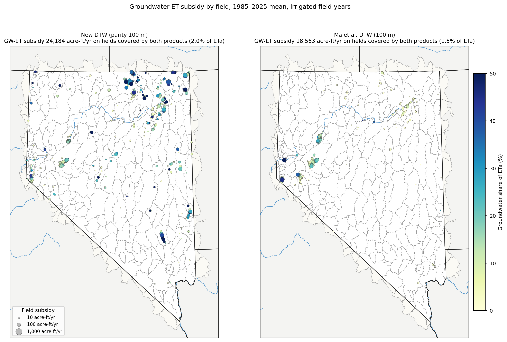

**Fig. 10.** Subsidy by field with each depth-to-groundwater map (the new map and Ma et al.
2026): circle size = acre-ft/yr, color = share of the field's ETa.

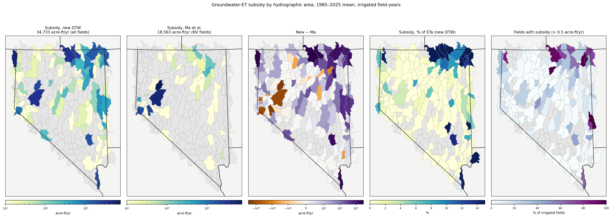

**Fig. 13.** HA subsidy with each map (log scale), the difference between them, the
subsidy as a share of ETa, and the share of irrigated fields that receive a subsidy.

[GW_SUBSIDY.md](GW_SUBSIDY.md) has the comparison of the two depth-to-groundwater maps in
full (Figs. 10–14).
